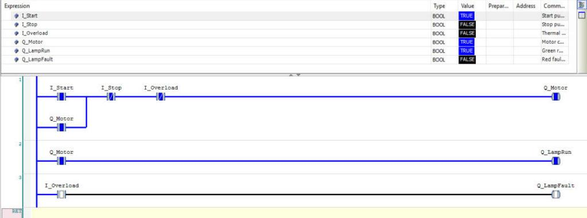
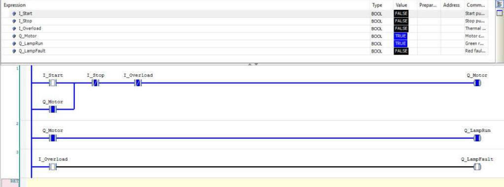

# Lesson 1 — Start/Stop Motor (Seal-in / Latching Circuit)

> The seal-in rung is the "Hello World" of PLC programming. You will find it in
> almost every machine. Understand this one deeply and the rest becomes easy.

## The problem

A conveyor motor has two push buttons:

* Press **START** → motor runs, and **keeps running** after you release the button.
* Press **STOP** → motor stops.
* If the motor **overload** relay trips (motor too hot / jammed) → motor stops and a fault lamp turns on.

A push button is only TRUE **while your finger is on it**. So we need the PLC to
"remember" that START was pressed. That memory is the **seal-in**.

## I/O list

| Tag | Address (example) | Type | Description |
|-----|-------------------|------|-------------|
| `I_Start` | `%IX0.0` | BOOL | Start push button, NO (1 = pressed) |
| `I_Stop` | `%IX0.1` | BOOL | Stop push button (1 = pressed, see note) |
| `I_Overload` | `%IX0.2` | BOOL | Thermal overload contact (1 = tripped) |
| `Q_Motor` | `%QX0.0` | BOOL | Motor contactor coil |
| `Q_LampRun` | `%QX0.1` | BOOL | Green "running" lamp |
| `Q_LampFault` | `%QX0.2` | BOOL | Red "fault" lamp |

> **On site note:** real Stop buttons are wired NC (fail-safe). Then `I_Stop` = 1 when
> *not* pressed, and in the program you would use `[ I_Stop ]` instead of `[/ I_Stop ]`.
> See [fundamentals §4](../../docs/00_plc_fundamentals.md#4-the-nonc-trap-very-important-on-site).

---

## Ladder Diagram

```
Network 1 — Motor start/stop with seal-in
 |                                                                  |
 |----+----[ I_Start ]----+----[/ I_Stop ]----[/ I_Overload ]----( Q_Motor )----|
 |    |                   |                                         |
 |    +----[ Q_Motor ]----+                                         |
 |      (seal-in contact)                                           |

Network 2 — Run lamp
 |                                                                  |
 |---------[ Q_Motor ]------------------------------------( Q_LampRun )----|

Network 3 — Fault lamp
 |                                                                  |
 |---------[ I_Overload ]---------------------------------( Q_LampFault )--|
```

---

## Net-by-net explanation

### Network 1 — Motor start/stop with seal-in

Read it as a sentence:

> **Motor = (Start OR Motor already running) AND NOT Stop AND NOT Overload**

| Element | What it checks | Why it is there |
|---------|----------------|-----------------|
| `[ I_Start ]` | Is START pressed? | The way to *begin* running. |
| `[ Q_Motor ]` (parallel branch) | Is the motor *already* ON? | **Seal-in.** Once the motor is ON, this branch keeps the rung powered after START is released. The output "holds itself". |
| `[/ I_Stop ]` | Is STOP **not** pressed? | When STOP is pressed this contact opens → path broken → motor OFF. Because it is in **series after** the OR, STOP always wins. |
| `[/ I_Overload ]` | Is overload **not** tripped? | Protection. Breaks the path when the motor overheats. |
| `( Q_Motor )` | Writes the result | TRUE if there is a complete path from left to right. |

**What happens scan by scan** (1 = TRUE):

| Scan | Event | I_Start | I_Stop | Branch A `[I_Start]` | Branch B `[Q_Motor]` (value from last scan) | Result `Q_Motor` |
|------|-------|:---:|:---:|:---:|:---:|:---:|
| 1 | Idle | 0 | 0 | 0 | 0 | **0** |
| 2 | Operator presses START | 1 | 0 | 1 | 0 | **1** ← motor starts |
| 3 | Still holding START | 1 | 0 | 1 | 1 | **1** |
| 4 | Releases START | 0 | 0 | 0 | **1** | **1** ← seal-in holds it! |
| 5 | Running... | 0 | 0 | 0 | 1 | **1** |
| 6 | Presses STOP | 0 | 1 | 0 | 1 | **0** ← series NC opens |
| 7 | Releases STOP | 0 | 0 | 0 | 0 | **0** ← seal is broken, stays OFF |

Notice scan 4: the only reason the motor stays on is the `[ Q_Motor ]` contact
reading its *own* previous value. That is the whole trick.

**What if START and STOP are pressed together?** → Motor OFF. STOP is in series
with everything, so it has priority. This is called **stop-dominant** and it is
the safe way to design it.

**What if power fails and comes back?** → `Q_Motor` is a normal (non-retentive)
coil, so it starts at 0. The motor does **not** restart by itself. The operator
must press START again. This is a safety requirement on most machines.

### Network 2 — Run lamp

`Q_LampRun := Q_Motor` — the green lamp simply copies the motor output.
Because Net 2 runs **after** Net 1, it uses the value Net 1 just calculated in
the same scan, so the lamp and motor switch in the same scan.

### Network 3 — Fault lamp

`Q_LampFault := I_Overload` — the red lamp shows the overload input directly.
In a real machine you would usually *latch* the fault so it stays on until a
RESET button is pressed (try it in the exercise).

---

## See it live in CODESYS (power flow)

The project [codesys/Lesson01_StartStopMotor.project](../../codesys/) has this logic twice:
`PLC_PRG` (Structured Text) and `MotorLD` (Ladder). In online mode CODESYS paints every
wire and contact that has **power in blue**, and parts without power stay black.

**1. START pressed:** power flows through `I_Start`, the closed NC contacts `I_Stop` and `I_Overload`, and into the `Q_Motor` coil.



**2. START released (the seal-in):** `I_Start` is open (black), but power now goes **down through
the `Q_Motor` branch** and keeps the coil on. This is the whole idea of the seal-in.



Try it yourself: Online → Simulation → Login → Start (F5), open `MotorLD`, click an input's
*Prepared value* until it shows `TRUE`, then press **Ctrl+F7**.

---

## Structured Text

See [program.st](program.st). The key line:

```iecst
Q_Motor := (I_Start OR Q_Motor) AND NOT I_Stop AND NOT I_Overload;
```

It is **exactly** Network 1. `OR` = parallel branch, `AND` = series, `NOT` = NC contact.

---

## Exercises

1. Add a second START button at another location (`I_Start2`). *Hint: one more parallel branch.*
2. Add a second STOP button (`I_Stop2`). *Hint: one more NC contact in series.*
3. Make the fault lamp **latch**: it stays ON after the overload resets, until `I_Reset` is pressed.
   *Hint: use a seal-in again, or Set/Reset coils.*
4. Swap the order: put Network 2 **before** Network 1. What changes? *(Answer: the lamp is one scan late — you will never see it with your eyes, but on fast logic it matters.)*

Next: [Lesson 2 — Timers](../02_timers/)
